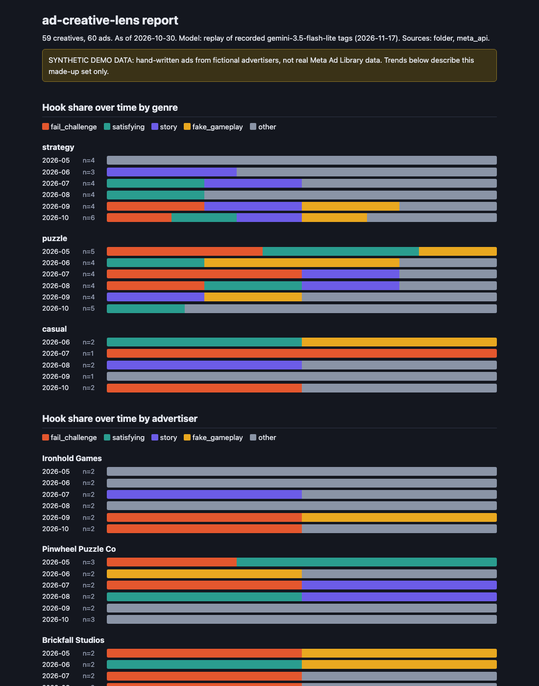

# ad-creative-lens

Tags mobile game ad creatives (hook, call to action, promised features) with an LLM and turns the tags into
user-acquisition creative trends: hook share over time per genre and advertiser, new-hook alerts, and
creative lifespan as a proxy for winners.

## Try it

**[Open the demo report](https://oguzhanozfe.github.io/ad-creative-lens/)** (synthetic data, no install needed).

[](https://oguzhanozfe.github.io/ad-creative-lens/)

```bash
git clone https://github.com/oguzhanozfe/ad-creative-lens && cd ad-creative-lens
python -m adlens demo          # Python 3.10+, stdlib only; writes out/index.html
```

`demo` tags the bundled ads (the API-shaped fixtures and the local-folder input) and builds the report. It
picks a model automatically and never needs a key:

1. `GEMINI_API_KEY` (or `DEEPSEEK_API_KEY`) set → that cloud model, live.
2. Else a local Ollama at `127.0.0.1:11434` with `qwen3.5:9b` → local, live (slower: one request per ad).
3. Else **replay** of the recorded `gemini-3.5-flash-lite` tags from 2026-11-17 in
   [`fixtures/tag_cache.jsonl`](fixtures/tag_cache.jsonl), printed as `mode: replay (...)`.

If a live model fails (bad key, quota), it falls back to replay. `python -m adlens demo --replay` skips the
live models; CI runs it that way and checks that the published page matches.

**The bundled data is synthetic.** The ads are hand-written in the shape of the Meta Ad Library
`ads_archive` / `ArchivedAd` response; advertisers, page ids and ad ids are fictional. The trends in the demo
describe that made-up set and nothing else.

### Use a real model or your own ads

- Your own ads, no account needed: a folder with `ads.csv` (+ screenshots/videos), then
  `python -m adlens run --folder my_ads --out out` (tagging needs a key or `--backend ollama`; see [With a local folder](#with-a-local-folder)).
- Your own key: `export GEMINI_API_KEY=...` and the commands use Gemini; `--backend ollama` for a local
  model.
- The **Meta Ad Library adapter is optional**: it needs your own identity-verified Meta token
  (see [With a real Ad Library token](#with-a-real-ad-library-token)). Nothing else depends on it.

## Why

UA teams in games spend a lot of time scrolling ad libraries to answer "what are competitors running
right now, and what's new?" The useful answer is a few structured tags per creative (hook, CTA, promised
feature) aggregated over time, plus a rough signal of which creatives survive. This repo is a small,
inspectable version of that pipeline: stdlib Python, a hosted model on the free tier or a local one.

## What it does

| Step | How |
|---|---|
| Ingest | `ads_archive` JSON pages (saved by `adlens fetch`) and/or `ads.csv` + media folder |
| Group | Ads with the same advertiser and same normalised copy become one *creative*; first/last seen span all its ads |
| Tag copy | LLM with a JSON schema (batched for cloud backends): `hook` (fail_challenge, satisfying, story, fake_gameplay, other), `cta` (install, play_now, pre_register, limited_offer, none), `features` (levels, offline, pvp, coop, rewards, customization, idle, story_choices). Definitions and tie rules are in [`adlens/tagger.py`](adlens/tagger.py) |
| Tag frames (optional) | `--vision`: if the chosen model accepts images, images (and video keyframes, if `ffmpeg` is installed) get a frame-level hook and visual elements. Otherwise text-only |
| Trends | Hook share per launch month by genre and advertiser; new-hook detection (a hook a group starts using after its first two months); creative lifespan |
| Report | One static HTML file, no JavaScript |

## Measured tagging agreement

All numbers below come from [`results/eval_live_run.json`](results/eval_live_run.json), written by the live
`python -m adlens eval` run, and [`results/eval.json`](results/eval.json) / [`results/eval.md`](results/eval.md),
regenerated from that run's cached tags with `--offline` (no API calls; same tags, plus copy text on each
disagreement).

- **Text tags model:** `gemini-3.5-flash-lite` (Gemini API, OpenAI-compatible endpoint, temperature 0,
  JSON-schema output), prompt `v1`, **batched 15 ad copies per request**. The run was interrupted and resumed
  from the on-disk cache, so `usage_this_run` in `eval_live_run.json` covers only the final leg.
- **Gold set:** 59 creatives, synthetic copy, one annotator (see Known limits). Split 50/50 by a hash of the
  ad id. This is not a real hold-out: the prompt's example phrases ("pull the pin", "48 hours", "send a
  challenge") were taken from fixture copy in both splits, so dev and test are shown side by side for
  transparency only. The prompt was not changed after seeing model output.

| split | n | hook acc | hook kappa | CTA acc | CTA kappa | features exact-set match |
|---|---|---|---|---|---|---|
| dev | 29 | 1.00 | 1.00 | 0.90 | 0.84 | 0.97 |
| test | 30 | 0.97 | 0.95 | 0.90 | 0.85 | 0.93 |
| all | 59 | 0.98 | 0.98 | 0.90 | 0.84 | 0.95 |

What the errors were (all 8 disagreements, with copy, are in `results/eval.json`):

- **`limited_offer` CTA: 0 of 5 found.** Every time-limited offer ("48 hours only", "Last chance… ends
  tonight", "Ends Sunday") was tagged as play_now, install or none. This is the clearest weakness. The
  prompt's tie rule (limited_offer beats other CTAs) was not followed.
- One disagreement is a **gold-label mistake**, not a model error: ad `800000000000127` ("Every choice
  changes the war. Ally with the north or burn their villages?") has no call to action, yet is labelled
  `play_now`. It has no character either, so its `story` gold label doesn't fit the written definition. The
  model said `other` / `none`. The label was left as is so the numbers match the committed run; 7 of the 8
  disagreement rows are model errors.
- Two extra features (`pvp` on a co-op raid ad, `offline` on an idle ad).

Per-class numbers with support counts are in [`results/eval.md`](results/eval.md). Classes are small
(test split: 2 limited_offer, 2 pre_register, 1 pvp), so single errors move them a lot.

**Frame tags:** 2 placeholder images were sent to `gemini-3.5-flash-lite`; the frame hook matched the text
hook for 0 of 2. Those images are solid colours, so that is the expected result and not a measurement.

A local run with `qwen3.5:9b` via Ollama was started and stopped at 31 of 61 calls. No local numbers are
reported.

## Run it

Needs Python 3.10+ (stdlib only). Tagging backends, chosen with `--backend`:

| backend | key | default model | images |
|---|---|---|---|
| `gemini` (default) | `GEMINI_API_KEY` | `gemini-3.5-flash-lite` | yes |
| `deepseek` | `DEEPSEEK_API_KEY` | `deepseek-chat` | no |
| `ollama` (local) | none | `qwen3.5:9b` | if the model reports `vision` |

`--vision-backend` / `--vision-model` pick a different model for keyframes. Responses are cached on disk
(`--cache`, keyed by model + prompt version + input), so reruns cost nothing. A 429 (quota) stops the run
with the API's message instead of retrying; rerun later and it resumes from the cache.

```bash
# 1. Same data as the demo, through the general `run` command, replaying the committed tag cache
python -m adlens run --api-dir fixtures/api --folder fixtures/folder --genres fixtures/genres.json \
  --cache fixtures/tag_cache.jsonl --offline --vision --out out
open out/report.html

# 2. Same, tagging live (needs GEMINI_API_KEY; or --backend ollama for a local model)
python -m adlens run --api-dir fixtures/api --folder fixtures/folder --genres fixtures/genres.json \
  --vision --cache out/tag_cache.jsonl --out out

# 3. Re-measure agreement against the hand labels
python -m adlens eval --api-dir fixtures/api --folder fixtures/folder --genres fixtures/genres.json \
  --labels fixtures/labels.csv --cache out/tag_cache.jsonl --out out

# tests (offline, no model needed)
python -m unittest discover -s tests -t .
```

### With a real Ad Library token

1. Get API access: confirm your identity at facebook.com/ID, create a Meta developer app, and generate a
   user access token (see Meta's [Ad Library API](https://www.facebook.com/ads/library/api/) page). Tokens
   expire; long-lived tokens last about 60 days.
2. Put it in the environment only. Never commit it.
   ```bash
   export META_AD_LIBRARY_TOKEN=...   # your own token
   ```
3. Fetch, then run on the saved pages:
   ```bash
   python -m adlens fetch --out data/raw --search-terms "puzzle game" --max-pages 5
   # or specific advertisers: --page-ids 1234567890,2345678901 (up to 10)
   python -m adlens run --api-dir data/raw --genres my_genres.json --out out
   ```
   `my_genres.json` maps advertiser page name to genre (`{"Some Studio": "puzzle"}`); the API has no
   genre field.

What `fetch` does: calls `graph.facebook.com/<version>/ads_archive` with `ad_type=ALL`,
`ad_active_status=ALL` (so ended ads count toward lifespan, not just survivors) and
`ad_reached_countries` set to the 27 EU countries by default, follows `paging.next`, waits 2 s between
pages, backs off on Graph rate-limit errors, and saves each page as JSON with every `access_token=`
value replaced by `REDACTED` (both `paging.next` and `ad_snapshot_url` carry it). It does not open
`ad_snapshot_url` or scrape the Ad Library website.

### With a local folder

`ads.csv` columns: `ad_id, advertiser, genre, first_seen, last_seen, text, media` (`media` is a
`;`-separated list of paths relative to the folder; `last_seen` empty means still running). See
[`fixtures/folder/`](fixtures/folder).

## Known limits

- **Synthetic validation set.** The 59 labelled creatives are hand-written copy, labelled by one annotator
  who also wrote the tagging prompt. No second annotator, so no inter-annotator baseline. Real ad copy is
  messier, often multilingual, often just a title. Treat the numbers as a sanity check of the prompt, not
  an accuracy estimate for real ads.
- **CTA wording is templated in the fixtures.** Most fixture CTAs are short appended phrases ("Download
  free.", "Play now."), which makes install/play_now easy; real copy is less tidy. The API also does not
  expose the actual CTA button, so this is CTA *wording* in the copy.
- **Batched tagging.** The reported numbers are from 15-per-request batches (to fit the Gemini free tier's per-day
  request limit). One-per-request tagging (`--batch-size 1`) was not measured.
- **fake_gameplay from text is a framing tag.** Whether an ad's gameplay is misleading can only be judged
  against the real game. From copy the tagger can only see mini-game framing ("pull the pin", "pick the
  right gate").
- **Frame tags are not validated.** The two bundled images are 16×16 solid-colour placeholders that only
  prove the plumbing. The Ad Library API returns no media files, so frame tagging applies only to the local
  folder path. Videos need `ffmpeg`; without it they are skipped with a message.
- **Lifespan is a proxy for winners.** The Ad Library gives no spend or results for non-political ads.
  A long run usually means an advertiser kept paying for it, but not always. Ads still running are
  measured to the `--as-of` date (default: the latest date in the data) and marked as running.
- **EU-only coverage.** Per Meta's docs, non-political ads are only returned if they reached the EU.
- **Fetch is untested against the live API** (no token). It is tested against a fake HTTP opener using the
  documented parameters and response shape.
- **Hung runs.** During the measured run, three attempts stalled for 10+ minutes before the cache-resumed
  run finished in seconds. The cause wasn't found; timeouts and a single retry are in place, so rerun if it
  stalls (the cache keeps finished work).
- `--batch-size 1` reuses tags cached by a batched run (the cache key doesn't include batch mode). Use a
  fresh `--cache` to compare modes.
- Prompt changes need a `PROMPT_VERSION` bump in `adlens/tagger.py`, or the cache will serve old tags (a
  test pins the prompt hash).

## Layout

```
adlens/ingest.py    API pages / folder CSV -> ads -> creatives; fetch with token scrubbing
adlens/tagger.py    taxonomy, prompt, Gemini/DeepSeek/Ollama clients, batching, cache, keyframes
adlens/trends.py    shares, new hooks, lifespans
adlens/evaluate.py  agreement vs hand labels (accuracy, Cohen's kappa, per-class)
adlens/report.py    static HTML
fixtures/           SYNTHETIC API pages, folder CSV, labels, generator script, committed tag cache
results/            committed eval output and report from the real Gemini run
docs/               GitHub Pages demo (index.html from `demo --replay`) and screenshot
```

MIT licensed.
